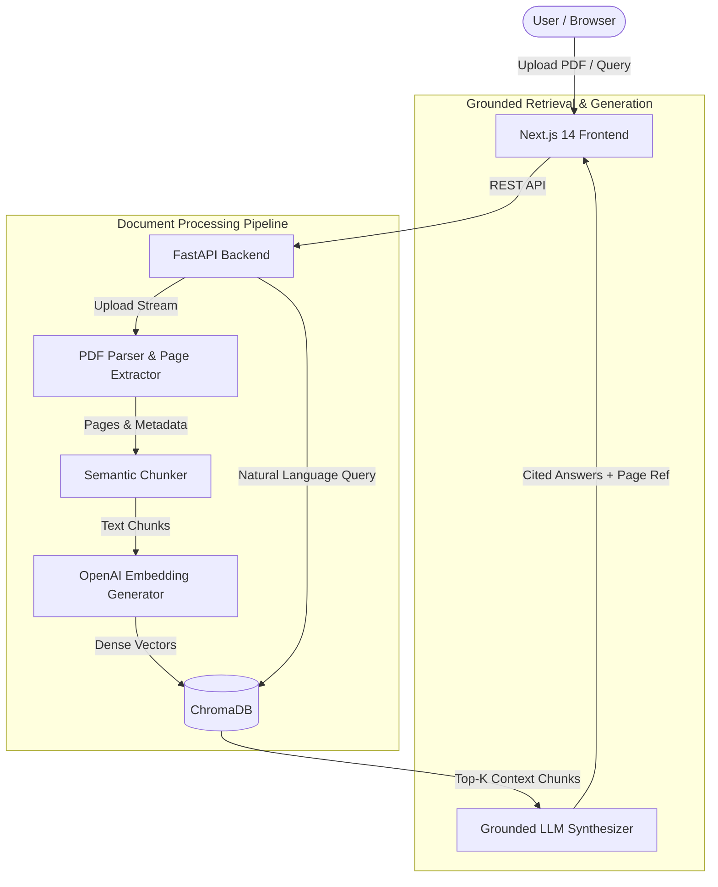

# DocuQuery — AI-Powered Document Intelligence Platform

[](https://fastapi.tiangolo.com/)
[](https://nextjs.org/)
[](https://www.typescriptlang.org/)
[](https://www.trychroma.com/)
[](https://openai.com/)
[](https://www.docker.com/)
[](LICENSE)

A full-stack **Retrieval-Augmented Generation (RAG)** platform enabling users to upload enterprise documents (PDFs, reports, manuals) and query them in natural language. Generates hallucination-resistant answers strictly grounded in source content and cited by precise page reference numbers.

---

## 🌟 Key Features

- **Multi-Page Text Extraction & Parsing:** Structured document parsing preserving exact page offsets and document metadata.
- **Semantic Chunking:** Context-aware text segmentation preventing boundary context loss across paragraphs and headings.
- **Dense Vector Search:** High-dimensional vector indexing using ChromaDB with cosine similarity retrieval.
- **Page-Level Grounded Citations:** RAG response synthesizer enforcing verifiable page citations for every factual statement.
- **Modern Full-Stack Stack:** Next.js 14 + TypeScript frontend paired with an asynchronous FastAPI backend.
- **Dockerized Architecture:** Multi-service orchestration for frontend, backend API, ChromaDB vector store, and PostgreSQL.

---

## 🏗️ System Architecture



---

## 📂 Project Structure

```
DocuQuery/
├── backend/
│   ├── app/
│   │   ├── api/routes.py          # Upload, Query & Document Endpoints
│   │   ├── core/
│   │   │   ├── parser.py          # PDF text extraction with page tracking
│   │   │   ├── chunker.py         # Semantic chunking engine
│   │   │   ├── embeddings.py      # OpenAI vector embedding generation
│   │   │   ├── vectorstore.py     # ChromaDB collection management
│   │   │   └── rag.py             # Grounded response synthesis & citations
│   │   ├── models/schemas.py      # Pydantic data schemas
│   │   ├── config.py              # Application settings
│   │   └── main.py                # FastAPI entrypoint
│   ├── Dockerfile
│   └── requirements.txt
├── frontend/
│   ├── src/
│   │   ├── app/page.tsx           # Document intelligence dashboard
│   │   └── components/            # Upload widget & cited Q&A interface
│   ├── package.json
│   └── tsconfig.json
├── docker-compose.yml
└── README.md
```

---

## 🚀 Quick Start

### 1. Environment Configuration
Create a `.env` file in the root directory:
```env
OPENAI_API_KEY=your_openai_api_key_here
CHROMA_PERSIST_DIR=./data/chroma
UPLOAD_DIR=./data/uploads
```

### 2. Launch with Docker Compose
```bash
docker-compose up --build
```
- Frontend: `http://localhost:3000`
- FastAPI Docs: `http://localhost:8000/docs`

---

## 🛡️ License
Distributed under the MIT License. See `LICENSE` for details.
